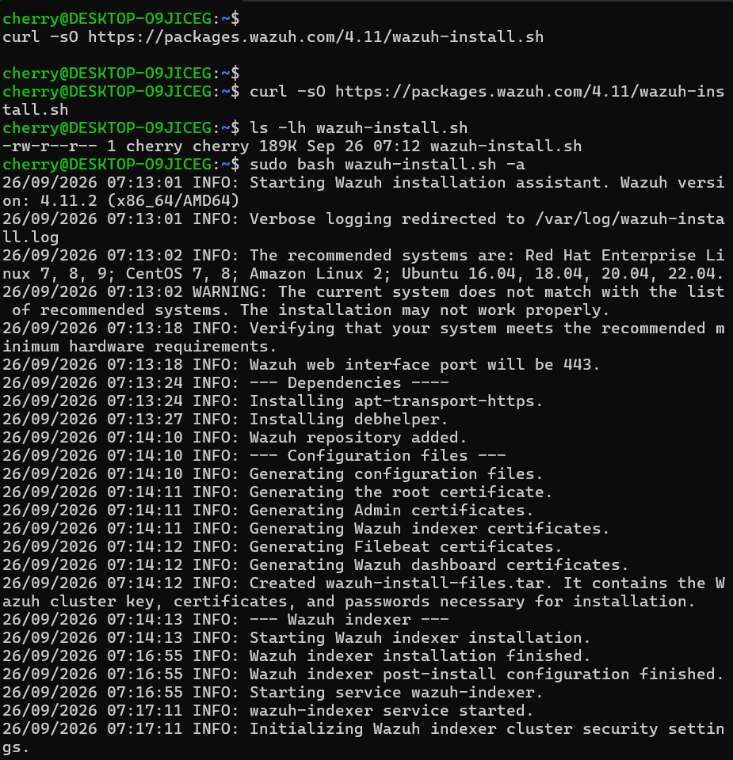
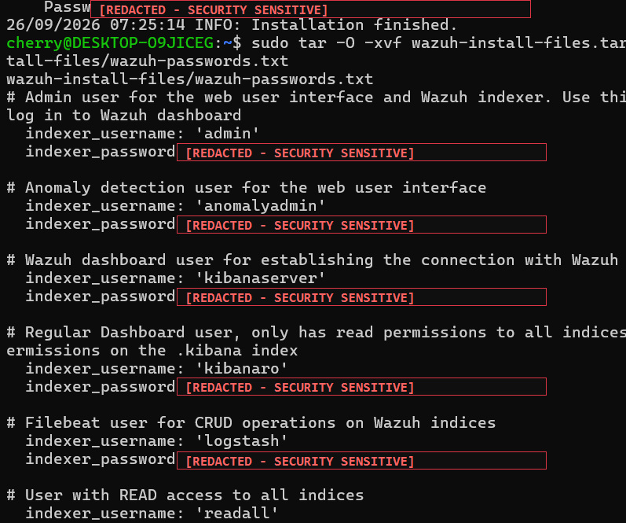
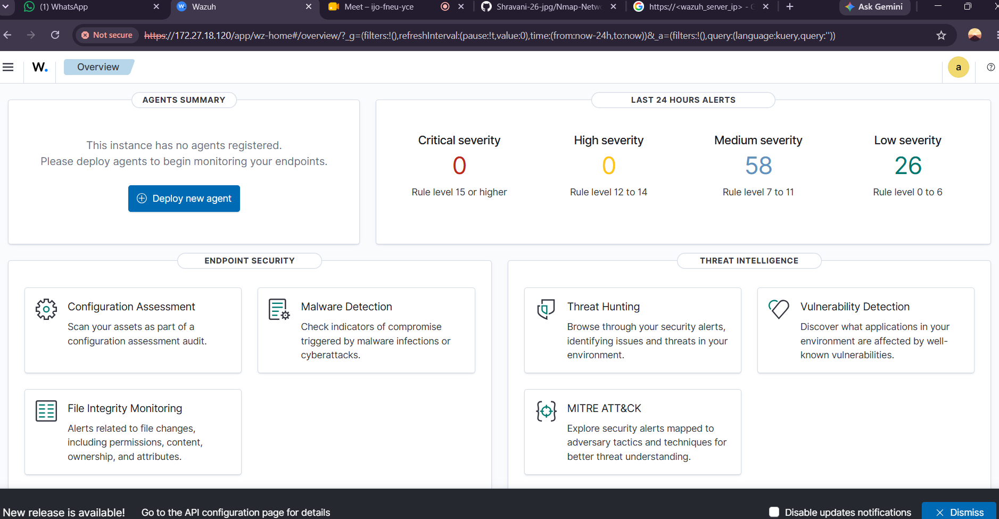
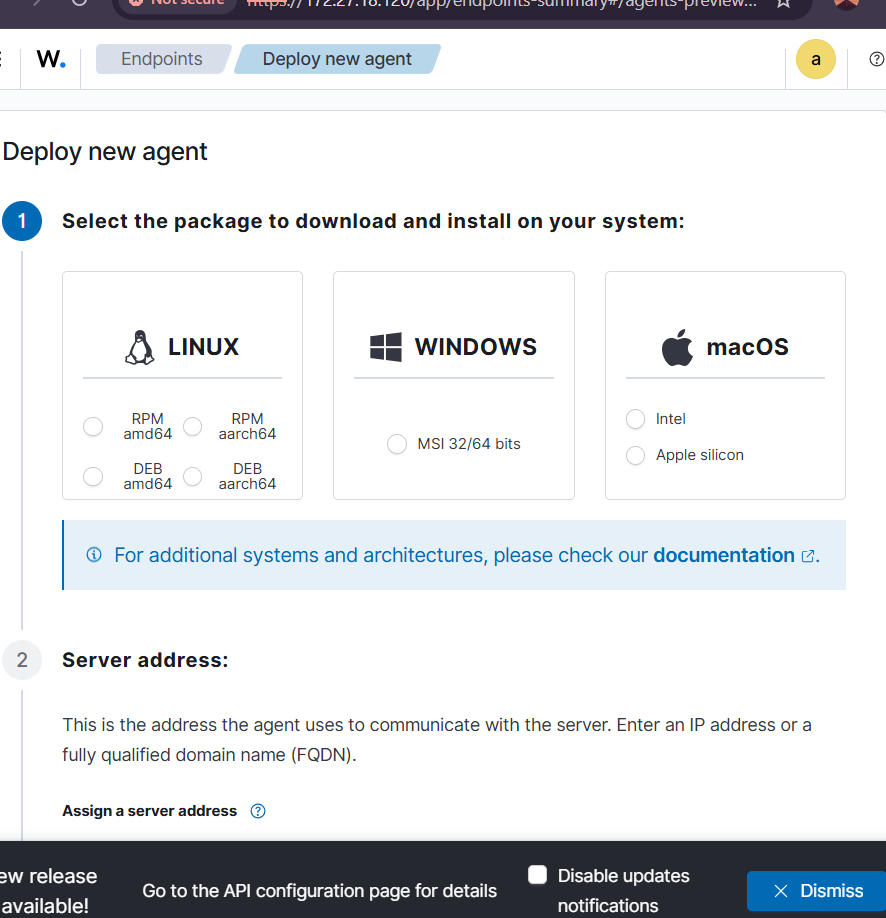
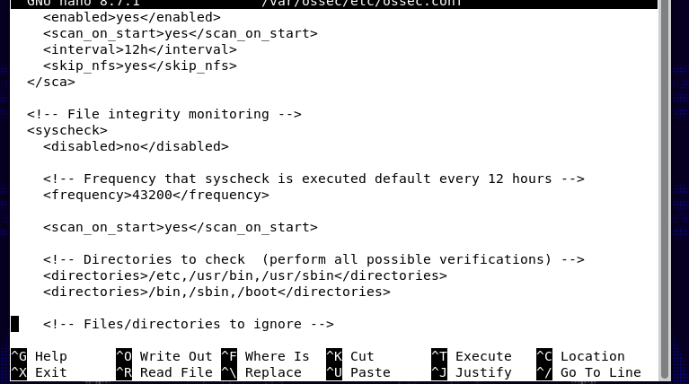
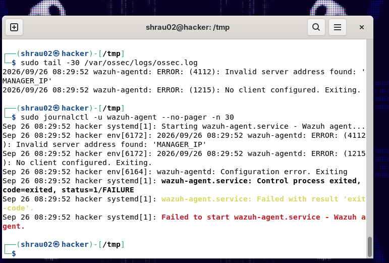
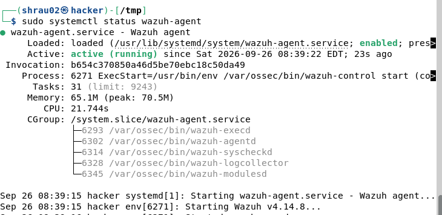
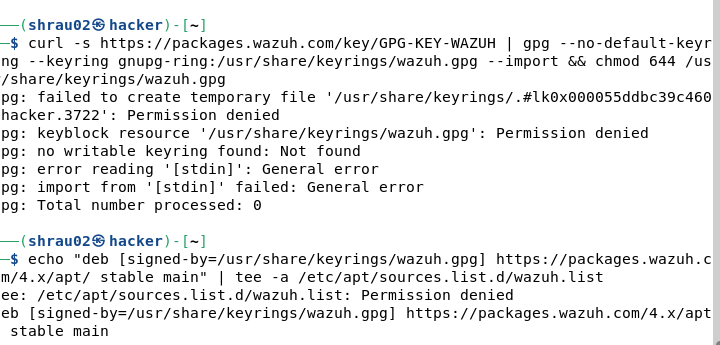
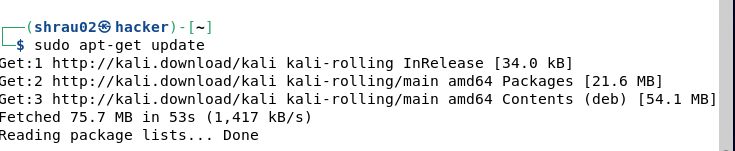
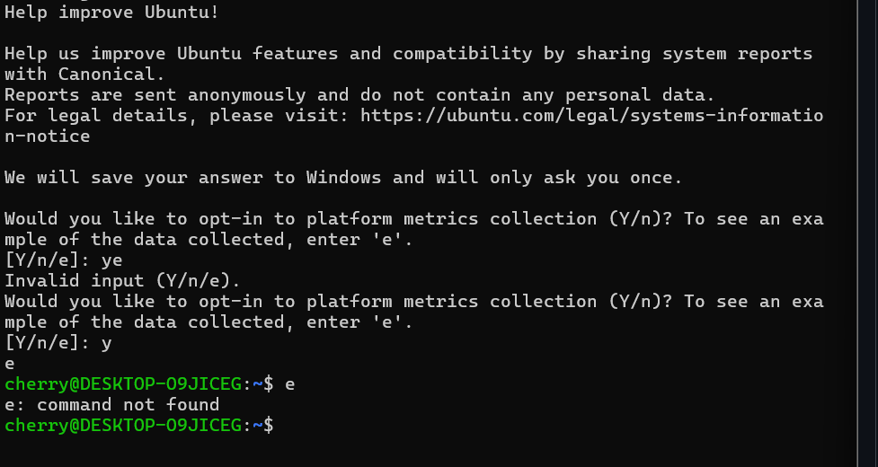

# Wazuh SIEM – Security Monitoring and Endpoint Detection

## Overview

Wazuh is an open-source security platform used for security monitoring, threat detection, log analysis, file integrity monitoring, vulnerability detection, and endpoint security.

This project documents my practical work with Wazuh, including installation, dashboard access, Wazuh agent configuration, troubleshooting, and endpoint monitoring.

---

## Objectives

- Install and configure Wazuh
- Access the Wazuh web dashboard
- Understand Wazuh server components
- Configure a Wazuh agent
- Connect an endpoint to the Wazuh server
- Monitor endpoint activity
- Perform File Integrity Monitoring
- Understand security alerts
- Troubleshoot Wazuh agent configuration
- Explore Wazuh security monitoring features

---

## Technologies and Tools

- **Wazuh** (v4.11)
- **Wazuh Indexer** (Search and analytical storage)
- **Wazuh Dashboard** (Web-based visualization UI)
- **Wazuh Agent** (Endpoint security telemetry daemon)
- **Linux / Ubuntu** (Wazuh Server Host Environment)
- **Kali Linux** (Monitored Endpoint Environment)
- **Bash** (Shell scripting and CLI administration)
- **Systemd** (Service initialization and lifecycle management)
- **File Integrity Monitoring (FIM)** (`syscheck`)
- **SIEM Concepts** (Log aggregation, event correlation, security alerting)
- **Endpoint Detection and Response (EDR)**

---

## Environment

The practical environment for this project consisted of a dedicated local virtualized lab network:

- **Wazuh Server Node:**
  - **Operating System:** Ubuntu Linux (`x86_64`)
  - **Role:** All-in-One Wazuh Server hosting Wazuh Manager, Wazuh Indexer, and Wazuh Dashboard.
  - **Management Access:** The Wazuh web dashboard was accessed via a web browser over HTTPS on a local private network IP address (`https://172.27.18.120`).
- **Endpoint / Monitored Node:**
  - **Operating System:** Kali Linux
  - **Role:** Monitored endpoint running the `wazuh-agent` service to forward telemetry, system logs, and file integrity data to the central server.

> **Security Note:** All dashboard access and management operations were conducted on a secure private test subnet. Credential information was intentionally redacted for security reasons, and no production secrets or unhashed passwords are published.

---

## Wazuh Architecture

Wazuh operates using a distributed client-server architecture:

```
┌─────────────────────────────────┐
│           Wazuh Agent           │  Installed on monitored endpoints (Linux, Windows, macOS)
└────────────────┬────────────────┘
                 │ (Encrypted security telemetry via TCP 1514)
                 ▼
┌─────────────────────────────────┐
│          Wazuh Manager          │  Analyzes logs, decodes events, checks against rules
└────────────────┬────────────────┘
                 │ (Parsed JSON events & alert documents)
                 ▼
┌─────────────────────────────────┐
│          Wazuh Indexer          │  Stores, indexes, and enables fast full-text searching
└────────────────┬────────────────┘
                 │ (Elasticsearch / OpenSearch REST API)
                 ▼
┌─────────────────────────────────┐
│         Wazuh Dashboard         │  Web-based visualization and investigation interface
└─────────────────────────────────┘
```

### Component Breakdown
1. **Wazuh Agent:** Installed on endpoints to collect real-time events, execute file integrity checks, inspect system logs, and monitor security configuration compliance.
2. **Wazuh Manager:** The brain of the SIEM. It receives events from agents, passes them through decoders, applies detection rules, detects anomalies, and generates security alerts.
3. **Wazuh Indexer:** A clustered, distributed OpenSearch-based indexer that stores all alerts, telemetry data, and system events for fast searching and historical analysis.
4. **Wazuh Dashboard:** The graphical web UI used by security analysts to review alerts, assess compliance, monitor endpoints, and track threats mapped to the MITRE ATT&CK matrix.

---

## Installation

The all-in-one installation assistant script was used to deploy the Wazuh central server components on the Ubuntu host.

### Step 1: Download the Installation Assistant

```bash
curl -sO https://packages.wazuh.com/4.11/wazuh-install.sh
```

### Step 2: Execute the Automated All-in-One Installation

```bash
sudo bash wazuh-install.sh -a
```

The `-a` (all-in-one) flag instructs the installation assistant to automatically install and configure the Wazuh Indexer, Wazuh Manager, Filebeat, and Wazuh Dashboard on the same host, generating internal certificates and administrative credentials.



Upon completion, the installer packaged internal cluster keys, SSL certificates, and initial administrator credentials into `wazuh-install-files.tar`. 

> **Notice:** Generated credentials were kept private. Credential information was intentionally excluded/redacted for security reasons.



---

## Wazuh Dashboard

The Wazuh Dashboard provides a single-pane-of-glass web interface for real-time security monitoring and threat management:

- **Security Alerts:** Live feed of categorized alerts by severity (Critical, High, Medium, Low).
- **Agents Overview:** Total registered agents, active agents, pending, and disconnected states.
- **Endpoint Security:** Modules for Configuration Assessment, Malware Detection, and File Integrity Monitoring.
- **Threat Hunting:** Query-driven investigation workspace for log exploration and incident analysis.
- **Vulnerability Detection:** Real-time visibility into CVEs affecting monitored assets.
- **MITRE ATT&CK Matrix:** Interactive mapping of active events to adversary tactics and techniques.



---

## Agent Deployment

Wazuh provides flexible multi-platform agent support:

- **Linux:** Native packages for Debian/Ubuntu (`.deb`), RHEL/CentOS/Fedora (`.rpm`), and source builds.
- **Windows:** Standard MSI installer (`32-bit` / `64-bit`) with automated service enrollment.
- **macOS:** Universal installer packages supporting both Intel and Apple Silicon architectures.

The dashboard's **Deploy new agent** guide streamlines deployment by generating the exact commands needed to install the package and enroll the endpoint to the manager's IP address.



---

## File Integrity Monitoring

**File Integrity Monitoring (FIM)** is a core endpoint security capability powered by the `wazuh-syscheckd` engine. FIM detects unauthorized changes to critical system binaries, libraries, and user directories:

- **File Modifications:** Analyzes changes in file size and cryptographic checksums (MD5, SHA-1, SHA-256).
- **Permission Changes:** Alerts when file mode bits (read/write/execute) are altered.
- **Ownership Changes:** Detects when owner UID or group GID changes occur.
- **Attribute Changes:** Monitors inode modifications, timestamps, and extended attributes.

FIM was configured within the `<syscheck>` section of `/var/ossec/etc/ossec.conf`:

```xml
<!-- File integrity monitoring -->
<syscheck>
  <disabled>no</disabled>
  <frequency>43200</frequency>
  <scan_on_start>yes</scan_on_start>

  <!-- Directories to check (perform all possible verifications) -->
  <directories>/etc,/usr/bin,/usr/sbin</directories>
  <directories>/bin,/sbin,/boot</directories>
</syscheck>
```



---

## Troubleshooting

During the practical setup and configuration, several real-world operational challenges were encountered and resolved.

### Issue 1 – Wazuh Agent Configuration Error

- **Problem:** When starting the Wazuh agent service on the endpoint, the service entered a failure state. Inspecting `/var/ossec/logs/ossec.log` and `journalctl -u wazuh-agent` revealed:
  ```text
  wazuh-agentd: ERROR: (4112): Invalid server address found: 'MANAGER_IP'
  wazuh-agentd: ERROR: (1215): No client configured. Exiting.
  wazuh-agent.service: Failed with result 'exit-code'.
  ```
- **Root Cause:** The agent was initially installed or started without substituting the placeholder `'MANAGER_IP'` in `/var/ossec/etc/ossec.conf` with the actual IP address of the Wazuh Manager server.
- **Resolution:**
  1. Edited `/var/ossec/etc/ossec.conf` and updated `<address>MANAGER_IP</address>` to the manager's private IP (`172.27.18.120`).
  2. Restarted the agent service:
     ```bash
     sudo systemctl restart wazuh-agent
     ```
  3. Verified that the agent service successfully transitioned to `active (running)`.





---

### Issue 2 – Wazuh Repository Permission Error

- **Problem:** During repository key import on Kali Linux, running the GPG and source list creation commands without root privileges caused permission failures:
  ```text
  gpg: failed to create temporary file '/usr/share/keyrings/...': Permission denied
  tee: /etc/apt/sources.list.d/wazuh.list: Permission denied
  ```
- **Root Cause:** Keyring directories (`/usr/share/keyrings/`) and APT package source configuration directories (`/etc/apt/sources.list.d/`) are system-level directories protected from unprivileged modification.
- **Resolution:** Prepended `sudo` to administrative commands and verified package updates with `sudo apt-get update`:
  ```bash
  curl -s https://packages.wazuh.com/key/GPG-KEY-WAZUH | sudo gpg --no-default-keyring --keyring gnupg-ring:/usr/share/keyrings/wazuh.gpg --import
  sudo chmod 644 /usr/share/keyrings/wazuh.gpg
  echo "deb [signed-by=/usr/share/keyrings/wazuh.gpg] https://packages.wazuh.com/4.x/apt/ stable main" | sudo tee /etc/apt/sources.list.d/wazuh.list
  sudo apt-get update
  ```





---

### Issue 3 – Ubuntu Platform Metrics

- **Problem:** During the initial terminal setup on Ubuntu, Canonical's interactive prompt was presented asking whether to opt in to platform metrics collection (`[Y/n/e]:`).
- **Explanation:** Ubuntu provides an optional system telemetry reporting mechanism during initial configuration. An invalid option entry was corrected, completing the shell environment setup for subsequent Wazuh installation steps.



---

## Verification

To verify agent operation, service health, and File Integrity Monitoring, the following commands and tests were performed:

### Service Health and Log Verification

```bash
# Verify active status of the Wazuh Agent daemon
sudo systemctl status wazuh-agent

# Inspect the most recent 30 lines of agent operational logs
sudo tail -30 /var/ossec/logs/ossec.log

# Check systemd journal logs for wazuh-agent execution details
sudo journalctl -u wazuh-agent --no-pager -n 30
```

### File Integrity Monitoring Test

A test file was created on the endpoint to trigger the File Integrity Monitoring engine:

```bash
echo "Hello Wazuh" > /home/<username>/test.txt
```

*(Where `<username>` represents the local endpoint user account).*


---

## Screenshots

| No. | Screenshot | Description |
|:---:|:---|:---|
| 1 | `01-ubuntu-setup.png` | Ubuntu setup & environment initialization |
| 2 | `02-wazuh-installation.png` | Wazuh all-in-one assistant installation process |
| 3 | `03-wazuh-credentials.png` | Wazuh installation credentials (**REDACTED / EXCLUDED**) |
| 4 | `04-wazuh-dashboard.png` | Wazuh Dashboard web interface overview |
| 5 | `05-kali-repository-error.png` | Wazuh repository key permission error |
| 6 | `06-apt-update.png` | APT package index update on Kali Linux |
| 7 | `07-wazuh-agent-error.png` | Initial Wazuh agent configuration issue (`MANAGER_IP`) |
| 8 | `08-wazuh-agent-running.png` | Wazuh agent service confirmed active & running |
| 9 | `09-ossec-configuration.png` | `ossec.conf` File Integrity Monitoring configuration |
| 10 | `10-test-file-created.png` | Test file creation for File Integrity Monitoring |
| 11 | `11-deploy-new-agent.png` | Wazuh agent deployment wizard interface |

### Screenshot Walkthrough

#### 1. Ubuntu Setup


#### 2. Wazuh Installation


#### 3. Wazuh Generated Credentials (Redacted)
> **Security Notice:** Credential information was intentionally excluded/redacted for security reasons.


#### 4. Wazuh Dashboard


#### 5. Repository Permission Error


#### 6. APT Update


#### 7. Agent Configuration Error


#### 8. Agent Service Running


#### 9. ossec.conf Configuration


#### 10. Test File Creation


#### 11. Deploy New Agent


---

## Learning Outcomes

Completing this practical provided hands-on experience and foundational knowledge across core cyber defense domains:

- **SIEM Fundamentals:** Practical understanding of centralized log aggregation, event indexing, and alert visualization.
- **Endpoint Monitoring:** Hands-on experience configuring endpoints to collect and relay real-time telemetry.
- **Security Alerting:** Understanding rule severity classification (Rule Levels 0–15) and alert prioritization.
- **Wazuh Architecture:** Direct exposure to the interaction between the Agent, Manager, Indexer, and Dashboard.
- **Agent-Server Communication:** Configuring encrypted network channels and troubleshooting connectivity parameters.
- **File Integrity Monitoring:** Implementing baseline directory monitoring to detect unauthorized additions or modifications.
- **Linux Service Management:** Managing and debugging background daemons using `systemctl`, `journalctl`, and service log files.
- **Security Troubleshooting:** Diagnosing configuration syntax errors, file permission restrictions, and network address misconfigurations.
- **Basic SOC Concepts:** Exposure to threat hunting workflows and industry-standard MITRE ATT&CK framework mapping.

---

## Conclusion

This practical demonstrates the deployment, configuration, and troubleshooting of Wazuh as a centralized SIEM and endpoint security solution. By working through automated server installation, dashboard navigation, endpoint agent configuration, and File Integrity Monitoring validation, this project reinforces critical skills required in modern Security Operations Center (SOC) environments and defensive cybersecurity practices.

---

## Disclaimer

This project was performed in a controlled learning/lab environment for educational purposes.

No production credentials, secrets, or sensitive network information are committed to this repository. All passwords and sensitive tokens have been strictly redacted or excluded in compliance with cybersecurity best practices.
